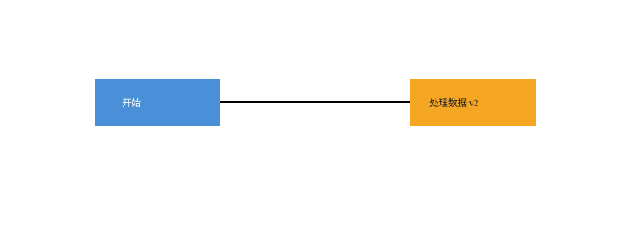

# SVG CLI

用命令绘制、组合和修改 SVG 的 TypeScript 编辑器。面向 Windows，课程 Lab1 Phase 1。

输入一条条命令，创建矩形、圆形、文字和分组，最后保存成可直接在浏览器里打开的矢量图。无需了解 SVG 代码。

## Windows 下载运行

1. 打开 [Releases](https://github.com/Monthlyaway/svg-cli/releases)，下载 `svg-cli-版本号-win-x64.zip`，解压到有写入权限的文件夹，例如 `D:\Tools\svg-cli`。
2. 在解压后的文件夹空白处右键，选择“在终端中打开”。在 PowerShell 输入 `./svg-cli.cmd`。
3. 看到 `svg>` 后输入以下命令；每行按回车（不要输入示例中的提示符）：

```text
init 400 200
create rect card 30 40 340 120 #e8f2ff
create text title 60 105 "Hello SVG"
save hello.svg
exit
```

把生成的 `hello.svg` 拖到 Edge 或 Chrome 窗口，即可看到浅蓝色卡片和文字。发布包包含 Node.js 运行时，Windows 10/11 x64 无需安装 Node 或 npm。源码 ZIP 是开发者入口，不是免安装包。

从概念、坐标、分组到撤销、导入和脚本的完整引导见 [小白教程](doc/TUTORIAL.md)。查语法见 [命令速查](doc/COMMANDS.md)，架构方案、过程记录、一致性自查和质量保证手段见 [课程文档](doc/README.md)。



## 开发

安装 Node.js 24，在 PowerShell 中运行：

```powershell
git clone https://github.com/Monthlyaway/svg-cli.git
cd svg-cli
npm ci
npm run build
npm run cli
npm run check
```

`npm run check` 编译、运行单元/集成/回归测试，再重放四个实际验收案例并比对 SVG 基准。生成物在 `artifacts/acceptance/`，不提交到 Git。`npm run release` 在检查通过且工作区干净时构建 Windows 包和 SHA256 校验文件，详见 [发布流程](doc/RELEASING.md)。

## 版本策略

小步提交代码与对应文档；语义版本 tag 标记发布，课程提交额外使用 `final`。发布包内 `release-manifest.json` 记录源码提交与运行时版本。变更见 [CHANGELOG](CHANGELOG.md)。
