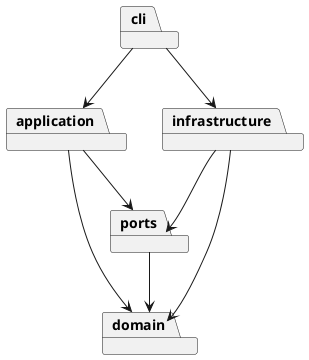

# 架构与交付记录

## 架构方案

| 模块 | 职责 | 允许依赖 |
|---|---|---|
| domain | Shape 多态、Composite 分组、Document 不变量 | 无外层依赖 |
| application | Command 执行、快照历史、文档会话 | domain、ports |
| ports | SVG 文件存储接口 | domain |
| infrastructure | XML 解析、SVG 序列化、文件适配 | domain、ports |
| cli | 参数解析、命令注册、REPL 与脚本入口 | application、domain、infrastructure |

外层调用内层，领域层不导入文件系统、终端或第三方 XML 库。命令名分派和图形名工厂为两处显式注册点；后续插件阶段应抽取注册接口，本阶段不提前实现插件系统。

使用 Command 将每个编辑操作封装成对象；快照装饰器统一实现原子执行与 undo/redo。Shape 为抽象组件，六种具体图形通过多态实现几何行为，Group 将同样的操作递归委派给子节点。存储使用端口隔离，避免命令直接依赖 XML 或磁盘。

变化点：新增图形可扩展工厂，新增命令可扩展注册表；新 UI 可复用 application；SVG 子集与持久化策略留在适配器。后续 box 插件不在本阶段实现。快照历史牺牲大文档内存效率以换取可验证的事务语义，后续可替换成增量逆操作。

## 过程记录

- 2026-10-29：核对原始课程说明，确认六种内建类型、文档操作历史屏障、顶层组不可 ungroup，以及必须有 `final` tag。建立分层结构和渐进交付约定，避免一次性提交。
- 第一轮实现：建立六种图形、封装的属性验证和递归组合模型。分组按文档遍历顺序收编，插入最早成员原位置；禁止祖先和子孙同时收编。发现 TypeScript 6 的 Node 类型需显式声明，已补齐配置。

## 一致性自查

当前 domain 不依赖外层；各类独立文件。领域测试覆盖多态几何、层级重排、深拷贝和输入边界；CLI 与文件适配尚待接入。

## 质量保证手段

计划围绕领域不变量、命令事务/历史、SVG 往返和 Windows 真实入口建立有限且有目的的测试。测试要有明确失效风险，不按数量堆积；最终加入课程流程图和额外两个验收案例，并实际预览生成文件。
