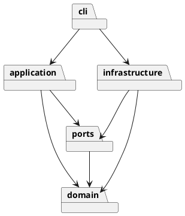

# 架构与交付记录

## 架构方案

| 模块 | 职责 | 允许依赖 |
|---|---|---|
| domain | Shape 多态、Composite 分组、Document 不变量 | 无外层依赖 |
| application | Command 执行、快照历史、文档会话 | domain、ports |
| ports | SVG 文件存储接口 | domain |
| infrastructure | XML 解析、SVG 序列化、文件适配 | domain、ports |
| cli | 参数解析、命令注册、REPL 与脚本入口 | application、domain、infrastructure |

外层调用内层，领域层不导入文件系统、终端或第三方 XML 库。命令名分派和图形名工厂为两处显式注册点；后续插件阶段应抽取注册接口，本阶段不提前实现插件系统。

使用 Command 将每个编辑操作封装成对象；快照装饰器统一实现原子执行与 undo/redo。Shape 为抽象组件，六种具体图形通过多态实现几何行为，Group 将同样的操作递归委派给子节点。存储使用端口隔离，避免命令直接依赖 XML 或磁盘。

变化点：新增图形可扩展工厂，新增命令可扩展注册表；新 UI 可复用 application；SVG 子集与持久化策略留在适配器。后续 box 插件不在本阶段实现。快照历史牺牲大文档内存效率以换取可验证的事务语义，后续可替换成增量逆操作。

## 过程记录

- 2026-10-29：核对原始课程说明，确认六种内建类型、文档操作历史屏障、顶层组不可 ungroup，以及必须有 `final` tag。建立分层结构和渐进交付约定，避免一次性提交。
- 第一轮实现：建立六种图形、封装的属性验证和递归组合模型。分组按文档遍历顺序收编，插入最早成员原位置；禁止祖先和子孙同时收编。当前 TypeScript 的 Node 类型需显式声明，已补齐配置。
- 第二轮实现：完整命令、UTF-8 脚本、XML 适配和磁盘存储。通过构造分组缩放溢出的失败场景，检验部分修改会整体回滚；通过失败 read/save 检验历史不被清空。XML 导入先扫描显式 ID，自动 ID 跳过后续已命名元素。磁盘保存使用同目录临时文件再重命名。

## 一致性自查

实际目录符合上表；domain 不依赖外层，application 不依赖基础设施和 CLI；具体类独立文件。两处按名字注册分别为 CommandParser 和 ShapeFactory，图形的几何操作通过多态执行。

## 质量保证手段

当前 `npm test` 通过 12 个测试，约 1 秒（编译之外）：领域不变量、失败事务与历史屏障、35 步编辑的 undo-all/redo-all 回归、XML 特殊字符往返、自动 ID 冲突、真实磁盘覆盖和真实 CLI 子进程。测试按风险组织，相关边界使用表驱动，避免每个命令机械复制测试。最终还将加入课程流程图和额外两个验收案例，并预览生成文件。

## 目前的使用入口

`npm ci` → `npm run build` → `npm run cli`。在 `svg>` 输入 `help` 查看全部语法，输入 `exit` 退出。也可运行 `npm run cli -- --script commands.svgcli`，失败即停止并返回非零退出码；调试时用 `--keep-going`。路径相对于运行时工作目录，包含空格的路径需双引号。

支持 UTF-8 SVG 的 rect/circle/ellipse/line/text/g 及课程属性白名单；宽高为正数，viewBox 必须为 `0 0 width height`。导入缺省几何值为 0，缺省画布 800×600。暂不支持 transform、CSS style、path、tspan、百分比尺寸等外部编辑器特性，导入会明确拒绝。data-kind 容器降级为普通 g 并警告。最多 10,000 元素、64 层、5 MiB 输入；历史最多保留 100 条编辑。
