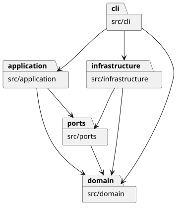
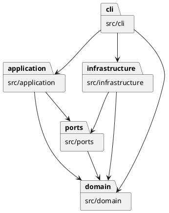

在线文档：[https://github.com/Monthlyaway/svg-cli/blob/main/doc/README.md](https://github.com/Monthlyaway/svg-cli/blob/main/doc/README.md)

# Lab1 Phase 1：SVG 编辑器（CLI）

## 架构方案

### 模块划分

| 模块（目录） | 职责 |
|---|---|
| `src/domain/` | 图形类层次与几何操作、分组组合结构、文档的唯一 ID 和树结构约束；不处理终端和文件读写 |
| `src/application/` | 编辑会话、命令执行、快照历史、撤销重做和显示格式；具体命令放在 `commands/` 子目录 |
| `src/ports/` | 定义 `DocumentStorage` 接口，约定文档读写及导入警告的返回形式 |
| `src/infrastructure/` | XML 解析、SVG 序列化和磁盘文件读写，实现存储接口 |
| `src/cli/` | 参数分词、命令名分发、REPL 与脚本入口，以及会话和存储实现的组装 |

`test/` 存放测试，`examples/` 存放验收脚本与 SVG 基准，`scripts/` 存放验收和发布脚本，`doc/` 存放文档。这些目录不参与生产代码的模块调用。

下图为 PlantUML 包图，箭头表示模块间允许的依赖方向：

对应的 PlantUML 源码：

### 设计模式的选择

1. **Command（命令模式，课程要求）**：将操作封装为实现 `Command` 接口的对象，具体命令位于 `src/application/commands/`，例如 `CreateCommand`、`MoveCommand` 和 `GroupCommand`。`CommandParser` 负责构造命令，`EditorSession.run()` 统一执行。这样参数解析与操作行为分离，交互和脚本可以使用同一套命令。
2. **Composite（组合模式）**：`Shape` 为抽象组件，`Rect`、`Circle`、`Ellipse`、`Line` 和 `Text` 为叶子，`Group` 为容器。`Group.move()` 和 `Group.scale()` 递归调用子节点的同名方法；`set` 使用共同的属性接口，`delete` 通过文档移除整棵子树。命令无需为每种图形重复分派，容器与叶子能接受统一操作。
3. **Decorator（装饰器模式）**：`SnapshotCommand` 实现 `Command` 并包装一个编辑命令，统一保存执行前后的文档快照。执行失败时回滚，成功后由 `EditorSession` 将其作为一个撤销单元管理；`undo()` 和 `redo()` 分别恢复前、后快照，避免每个编辑命令重复实现快照逻辑。

图形对象的创建集中在 `ShapeFactory` 的简单工厂中；存储通过 `DocumentStorage` 接口隔离，使命令不直接依赖 XML 库或磁盘实现。

按课程要求，仅保留两处按名字分派，并明确列为**待重构项**：`CommandParser` 的“命令名 → 命令对象”注册表、`ShapeFactory` 的“类型名 → 图形对象”注册表。后续扩展阶段再抽取可注册接口，本阶段不提前实现插件系统。

### 依赖方向规则

各模块内部允许相互引用；跨模块依赖仅允许以下方向，包图与本表保持一致：

| 模块 | 允许依赖的其他模块 | 理由 |
|---|---|---|
| `domain` | 无 | 图形行为和文档约束独立于界面、用例和存储方式 |
| `ports` | `domain` | 存储接口以领域文档作为输入、输出，不引用具体实现 |
| `application` | `domain`、`ports` | 命令操作领域对象，并通过存储接口完成读写，不直接依赖基础设施或 CLI |
| `infrastructure` | `domain`、`ports` | 适配器负责把 SVG、磁盘操作转换为领域文档，并实现存储接口 |
| `cli` | `application`、`domain`、`infrastructure` | 入口构造命令、使用领域数值校验，并组装会话和具体存储适配器 |

文件系统、终端和第三方 XML 库等外部依赖仅允许出现在 `cli` 或 `infrastructure`。违反以上规则的依赖须记入过程记录，作为待处理项；本次抽查未发现违反规则的导入。

### 变化点假设

| 未来最可能变化的地方 | 已保留的支持，或决定不预留的理由 |
|---|---|
| 新增或调整命令 | 命令实现独立成类，通过 `Command` 接口执行；当前修改 `CommandParser` 注册表即可增加入口。注册表扩展接口列为待重构项 |
| 新增图形类型 | 图形行为通过 `Shape` 多态实现，创建集中在 `ShapeFactory`；工厂的可注册接口列为待重构项。`box` 属于后续插件化阶段，本阶段不实现插件加载及其专用属性 |
| 增加 GUI 或其他交互入口 | 可复用 `application`、`domain` 和存储接口；当前只有 CLI，不预建第二套界面或通用 UI 框架 |
| 调整 SVG 支持范围或文件存储方式 | SVG 子集处理集中在 `SvgCodec`，磁盘操作集中在 `FileDocumentStorage`；其他存储实现可替换 `DocumentStorage` 的实现 |
| 大文档的撤销性能与内存占用 | 当前使用完整快照，优先保证失败回滚和历史恢复的正确性，并限制为 100 条历史；将来可调整 `SnapshotCommand` 的历史保存方式，本阶段不引入增量逆操作的复杂度 |

## 过程记录

- 2026-10-29：核对原始课程说明，确认六种内建类型、文档操作历史屏障、顶层组不可 ungroup，以及必须有 `final` tag。建立分层结构和渐进交付约定，避免一次性提交。
- 第一轮实现：建立六种图形、封装的属性验证和递归组合模型。分组按文档遍历顺序收编，插入最早成员原位置；禁止祖先和子孙同时收编。当前 TypeScript 的 Node 类型需显式声明，已补齐配置。
- 第二轮实现：完整命令、UTF-8 脚本、XML 适配和磁盘存储。通过构造分组缩放溢出的失败场景，检验部分修改会整体回滚；通过失败 read/save 检验历史不被清空。XML 导入先扫描显式 ID，自动 ID 跳过后续已命名元素。磁盘保存使用同目录临时文件再重命名。
- 第三轮验收：补充任务看板与平面图两个独立场景，并用真实 CLI 生成四份 SVG。浏览器预览发现看板的状态圆点被面板遮挡；原因是 back 后分组收编将整组留在背景之前，修正为解组前 front badge。验收不仅比对输出，还独立检查位置、归属和往返一致性。平面图初始计数预期误写 13，逐项核对树后更正为 12。
- 打包验证：本机 Windows PowerShell 子进程未提供 Get-FileHash，首次构建因此停止。改用 .NET SHA256 流式计算，避免打包依赖可选 cmdlet；未绕过运行时归档校验。
- 正式版前复查：发现 `in ""` 和 `tree ""` 因真值判断误当成未提供参数，改为显式判断 undefined，并合入失败原子性的回归表；补齐颜色十六进制长度校验。增加架构依赖/文件命名与 100 条历史容量检查，测试数从 12 调整到 14，没有重复堆叠每个命令的同类测试。
- 已用 0.1.0 ZIP 在中文与空格路径解压，清除 PATH 中的开发工具，用包内 `.cmd` 重放四个案例并比对输出。将这个过程固化为 Smoke-Release.ps1，额外验证独立工作目录和失败退出码。浏览器复查截图见 [browser-preview.png](browser-preview.png)。Visualize 交互演示解释分组移动与 undo/redo，真实输出仍以 examples 与 CLI 验收为准。
- 实际 TTY 试用捕获：交互终端里的 --script 报错原先退出码仍为 0，而管道测试正常。先加入终端属性入口回归得到失败，再调整 Main 区分脚本与交互 REPL，修复后真实终端也返回 1。PowerShell 脚本保存为带 BOM 的 UTF-8，兼容 Windows PowerShell 5.1 的中文路径字面量。
- 2026-10-30 文档修订：重新对照课程说明 §1.2，将本文整理为规定的四节，并把架构方案按原文四项分别展开。抽查导入发现原包图漏画 `cli → domain`，已补齐图示；两处名字分派明确标为待重构项。实际模块目录未变，本次修订涉及文档结构和架构描述。

## 一致性自查

1. **模块划分：实际目录与方案是否一致？不一致之处是否已记入修订记录？**

   一致。生产代码分为 `src/domain/`、`src/application/`、`src/ports/`、`src/infrastructure/` 和 `src/cli/`，具体命令位于 `src/application/commands/`，与方案逐项对应。未发现实际目录偏离方案的情况；原包图漏画依赖的描述修订已记入上面的过程记录。

2. **依赖方向：方案里的规则有没有被违反？**

   本次抽查未发现违反。`EditorSession` 导入 `domain/Document` 和 `ports/DocumentStorage`，不导入基础设施；`FileDocumentStorage` 实现存储接口并使用领域文档；`cli/Main` 负责组装具体存储和会话，`cli/CommandParser` 使用 `domain/NumberValue` 做数值校验；`domain` 只导入本模块代码。`test/architecture.test.ts` 同时扫描全部生产 TypeScript 文件的导入方向、类名与文件名，以及是否出现 `switch` 分派，本次运行通过。两处名字注册仍为上述待重构项，图形几何行为通过多态执行。

## 质量保证手段

以课程 `phase_cli_1.md` 中 Phase 1 的命令、约定和案例为验收依据。2026-10-30 在项目根目录执行 `npm run check`，TypeScript 编译、14 个测试和 4 个验收案例全部通过。

| 检查内容 | 方法与依据 |
|---|---|
| 功能是否完整 | 将课程命令总表与 `CommandParser`、各具体命令及 `HelpCommand` 对照；通过真实 CLI 子进程和四个脚本验证实际入口。六种图形、`in` 创建归属、编辑、显示和读写由领域、会话、存储及 CLI 测试共同覆盖 |
| 组合结构与属性约束 | `domain.test.ts` 检查六种图形的多态移动、缩放、公共样式，分组顺序、循环拒绝、嵌套解组、有限数值和属性白名单 |
| 失败原子性与撤销重做 | `session.test.ts` 检查编辑失败时文档及两栈不变、一命令一撤销单元、显示不入栈、分支清空 redo、成功 IO 的历史屏障和失败 IO 保留历史；另有 100 条历史容量及 35 步 undo-all/redo-all 回归 |
| SVG 与真实文件读写 | `storage.test.ts` 检查 UTF-8 和 XML 特殊字符往返、自动 ID 避让显式 ID、重复或不支持的 XML 拒绝，以及真实磁盘覆盖和失败后临时文件清理 |
| 命令行约定 | `cli.test.ts` 检查引号、空文本、Windows 路径、十六进制颜色，以及实际脚本入口的工作目录、UTF-8、遇错停止和非零退出码 |
| 架构与面向对象约束 | `architecture.test.ts` 检查生产代码导入方向、一类一文件和类名对应文件名，并禁止 `switch` 分派；结合上面的一致性抽查核对方案与实现 |
| 完整场景与可视结果 | `scripts/acceptance.mjs` 重放首次绘图、课程流程图、任务看板和平面图四个案例，核对元素数、关键坐标、归属、文本、SVG 往返和基准文件；原有浏览器预览记录见 [browser-preview.png](browser-preview.png) |

原有发布验证还使用 `npm run smoke:release`，从发布 ZIP 在中文、空格路径和独立工作目录中重放四个案例，隔离开发工具 PATH，并检查失败退出码；过程中的问题与修复已记录在“过程记录”。本次文档复核未重新构建发布包。

验收范围为课程本阶段的 `rect`、`circle`、`ellipse`、`line`、`text`、`g` 及属性白名单，`box` 按课程阶段边界不实现。当前 SVG 导入不支持 `transform`、CSS `style`、`path`、`tspan` 和百分比尺寸等外部编辑器特性，会明确拒绝；`data-kind` 容器降级为普通 `g` 并警告。画布宽高为正数，`viewBox` 要求为 `0 0 width height`；输入限制为 5 MiB、10,000 个元素和 64 层嵌套，历史最多 100 条。测试和人工验收为上述范围内的质量依据，不据此声称支持任意外部 SVG。
