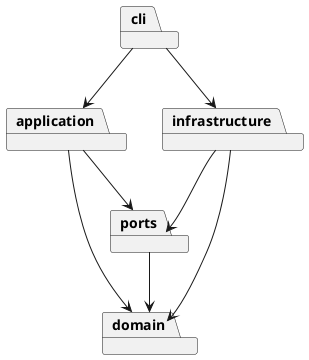

# 架构与交付记录

## 架构方案

| 模块 | 职责 | 允许依赖 |
|---|---|---|
| domain | Shape 多态、Composite 分组、Document 不变量 | 无外层依赖 |
| application | Command 执行、快照历史、文档会话 | domain、ports |
| ports | SVG 文件存储接口 | domain |
| infrastructure | XML 解析、SVG 序列化、文件适配 | domain、ports |
| cli | 参数解析、命令注册、REPL 与脚本入口 | application、domain、infrastructure |

外层调用内层，领域层不导入文件系统、终端或第三方 XML 库。命令名分派和图形名工厂为两处显式注册点；后续插件阶段应抽取注册接口，本阶段不提前实现插件系统。

使用 Command 将每个编辑操作封装成对象；快照装饰器统一实现原子执行与 undo/redo。Shape 为抽象组件，六种具体图形通过多态实现几何行为，Group 将同样的操作递归委派给子节点。存储使用端口隔离，避免命令直接依赖 XML 或磁盘。

变化点：新增图形可扩展工厂，新增命令可扩展注册表；新 UI 可复用 application；SVG 子集与持久化策略留在适配器。后续 box 插件不在本阶段实现。快照历史牺牲大文档内存效率以换取可验证的事务语义，后续可替换成增量逆操作。

## 过程记录

- 2026-10-29：核对原始课程说明，确认六种内建类型、文档操作历史屏障、顶层组不可 ungroup，以及必须有 `final` tag。建立分层结构和渐进交付约定，避免一次性提交。
- 第一轮实现：建立六种图形、封装的属性验证和递归组合模型。分组按文档遍历顺序收编，插入最早成员原位置；禁止祖先和子孙同时收编。当前 TypeScript 的 Node 类型需显式声明，已补齐配置。
- 第二轮实现：完整命令、UTF-8 脚本、XML 适配和磁盘存储。通过构造分组缩放溢出的失败场景，检验部分修改会整体回滚；通过失败 read/save 检验历史不被清空。XML 导入先扫描显式 ID，自动 ID 跳过后续已命名元素。磁盘保存使用同目录临时文件再重命名。
- 第三轮验收：补充任务看板与平面图两个独立场景，并用真实 CLI 生成四份 SVG。浏览器预览发现看板的状态圆点被面板遮挡；原因是 back 后分组收编将整组留在背景之前，修正为解组前 front badge。验收不仅比对输出，还独立检查位置、归属和往返一致性。平面图初始计数预期误写 13，逐项核对树后更正为 12。
- 打包验证：本机 Windows PowerShell 子进程未提供 Get-FileHash，首次构建因此停止。改用 .NET SHA256 流式计算，避免打包依赖可选 cmdlet；未绕过运行时归档校验。
- 正式版前复查：发现 `in ""` 和 `tree ""` 因真值判断误当成未提供参数，改为显式判断 undefined，并合入失败原子性的回归表；补齐颜色十六进制长度校验。增加架构依赖/文件命名与 100 条历史容量检查，测试数从 12 调整到 14，没有重复堆叠每个命令的同类测试。
- 已用 0.1.0 ZIP 在中文与空格路径解压，清除 PATH 中的开发工具，用包内 `.cmd` 重放四个案例并比对输出。将这个过程固化为 Smoke-Release.ps1，额外验证独立工作目录和失败退出码。浏览器复查截图见 [browser-preview.png](browser-preview.png)。Visualize 交互演示解释分组移动与 undo/redo，真实输出仍以 examples 与 CLI 验收为准。
- 实际 TTY 试用捕获：交互终端里的 --script 报错原先退出码仍为 0，而管道测试正常。先加入终端属性入口回归得到失败，再调整 Main 区分脚本与交互 REPL，修复后真实终端也返回 1。PowerShell 脚本保存为带 BOM 的 UTF-8，兼容 Windows PowerShell 5.1 的中文路径字面量。

## 一致性自查

实际目录符合上表；domain 不依赖外层，application 不依赖基础设施和 CLI；具体类独立文件。architecture.test.ts 自动检查生产代码的导入方向、类名与文件名及 switch 分派。两处按名字注册分别为 CommandParser 和 ShapeFactory，图形的几何操作通过多态执行。

## 质量保证手段

当前 `npm test` 通过 14 个测试，约 1 秒（编译之外）：架构约束、领域不变量、失败事务与历史屏障、历史容量、35 步编辑的 undo-all/redo-all 回归、XML 特殊字符往返、自动 ID 冲突、真实磁盘覆盖和真实 CLI 子进程。`npm run check` 额外重放四个验收案例，对照已预览的 SVG 基准。`npm run smoke:release` 独立检查发布 ZIP 的四个案例和失败退出码。生产依赖审计为 0 漏洞（2026-10-29）。测试按风险组织，相关边界使用表驱动，避免每个命令机械复制测试。

## 目前的使用入口

`npm ci` → `npm run build` → `npm run cli`。在 `svg>` 输入 `help` 查看全部语法，输入 `exit` 退出。也可运行 `npm run cli -- --script commands.svgcli`，失败即停止并返回非零退出码；调试时用 `--keep-going`。路径相对于运行时工作目录，包含空格的路径需双引号。

支持 UTF-8 SVG 的 rect/circle/ellipse/line/text/g 及课程属性白名单；宽高为正数，viewBox 必须为 `0 0 width height`。导入缺省几何值为 0，缺省画布 800×600。暂不支持 transform、CSS style、path、tspan、百分比尺寸等外部编辑器特性，导入会明确拒绝。data-kind 容器降级为普通 g 并警告。最多 10,000 元素、64 层、5 MiB 输入；历史最多保留 100 条编辑。

## Phase 1 逐条核对

依据用户提供的 `phase_cli_1.md`（SHA256 `D8BBF9409A9596035F13AE809888C64E813EA76966B649911536DA44EABC7F76`）核对；文档中的 box 案例明确属于下一阶段，不能误当本阶段必需功能。截止日期未在该文件给出，因此本项目只能记录实际 tag 时间，不能证明早于未提供的截止时间。

| 原文条目 | 实现与证据 |
|---|---|
| §1.1 分步 Git、远程推送、final | 分阶段提交及 v0.1.0 预发布、v1.0.0 正式发布；final 与正式版完成提交一致 |
| §1.2 架构、过程、自查、质量保证 | 本文件四个对应章节；PlantUML 包图见上方 |
| §2 TypeScript、OO、一类一文件 | src 各类独立；几何逻辑封装在 Shape 类层次 |
| §2 Command、Composite、仅两处分派 | application/commands；Group；CommandParser/ShapeFactory 注册表 |
| §2 唯一 ID、自动 ID、引号、注释 | Document、SvgCodec、Tokenizer；domain/storage/cli 测试 |
| §2 error 前缀、一行、失败不改状态 | Main 统一错误出口，SnapshotCommand 回滚；session 失败事务测试 |
| §3 文档命令与历史屏障 | Init/Read/Save/CanvasCommand，session IO 屏障测试 |
| §3 全部编辑与显示命令 | 独立 Command 类、HelpCommand 全表；真实 CLI 及四个案例 |
| §4.1 六种类型及 set 白名单 | 六个 Shape 子类、ShapeFactory，domain 验证与往返测试 |
| §4.1 in 创建归属 | CreateCommand → Document.add；flowchart 案例 |
| §4.2 规定错误和根级不可解组 | domain/session 的边界测试；未知 box 按 unknown shape type 拒绝 |
| §4.3 undo/redo 粒度与分支 | SnapshotCommand 与 EditorSession；35 步回归及分支测试 |
| §4.4 后续 box 不属本阶段 | 不实现插件，不提前添加 box；data-kind 降级 g 并警告 |
| §5 tree/show 格式 | TreeFormatter 输出分支线、内联属性与父容器；语义保持，属性排版不逐字符模仿样例 |
| §6 流程图及外部导入 | 02-flowchart；storage 测试覆盖缺 ID 外部 SVG；另加看板和平面图 |

使用方法见 [TUTORIAL.md](TUTORIAL.md)；语法见 [COMMANDS.md](COMMANDS.md)；发布维护见 [RELEASING.md](RELEASING.md)。保持首页导航与这四份职责明确的文档，不重复粘贴课程全文。
